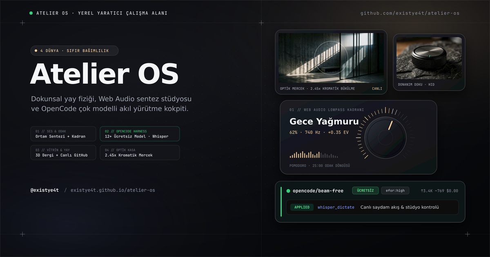

# Atelier OS

**Dört birleşik çalışma alanını tek yay-fiziği motorunda ve gerçek çok modelli AI harness'ında buluşturan yerel-öncelikli yaratıcı masaüstü ortamı.**

> Live Demo (GitHub Pages): **[existye4t.github.io/atelier-os](https://existye4t.github.io/atelier-os/)**



---

## Özellikler & 4 Dünya Mimarisi

1. **Odak & Ses Stüdyosu (`1`)**
   - Saf **Web Audio API** ile sentezlenen çok katmanlı ortam sesleri (*Gece Yağmuru*, *Obsidian Lo-Fi*, *Derin Yörünge*, *Atölye Şöminesi*)
   - Etkileşimli **Rotary Lowpass Kadranı**, çek-bırak **Karanlık / Aydınlık Aydınlatma İpi**, ortam pozlama (`EV`) ve **Pomodoro Odak Sayacı** + görev listesi

2. **AI Ajan Kokpiti (`2` · OpenCode-Inspired Harness)**
   - **Tıklanabilir Model Seçici Modalı (`Ctrl/Cmd + M`)**: OpenCode Zen ücretsiz modelleri (12+ reasoning/multimodal model), OpenCode Pro kataloğu, Pollinations, Google Gemini, OpenAI, OpenRouter, Anthropic Claude ve yerel Ollama desteği
   - **Reasoning Effort Seçici**: `Otomatik`, `Low`, `Med`, `High`, `Max` akıl yürütme seviyeleri
   - **Harness Modları**: `Build` (otonom uygulama), `Plan` (onay kapılı yürütme) ve `Chat` (salt kod/sohbet), sol çizgili oturum izi, açılır *Düşünce Süreci* ve token/maliyet telemetrisi
   - **Ücretsiz Çevrimdışı Sesli Dikte**: Zen Browser ve Chromium uyumlu yerel Whisper dikte + konuşurken sohbete saydam canlı döküm

3. **Portfolyo & 3D Dergi (`3`)**
   - Canlı `@existye4t` GitHub profil & öne çıkan repo senkronizasyonu (`flow`, `erenin-yatagi`, `exist-bw`, `darmoshark-packages`, `skin-fixer`, `lilium`)
   - Değişken font ağırlığı dalgası, proje yelpezesi (`Fan Cards`), sola/sağa kaydırmalı destek kartı ve köşeden tutularak çevrilen **3D Afin Sayfa Katlamalı Dergi**

4. **Fikir Kasası (`4`)**
   - Sürükle-bırak görsel/kod yükleyici, saf fotoğraf inceleme modlu **Optik Kromatik Büyüteç Lens (`2.45x`)**, etiket filtreleri ve SVG istatistik nabız grafiği

---

## Hızlı Başlangıç (Yerel Sunucu + AI & Dikte Köprüsü)

```bash
git clone https://github.com/existye4t/atelier-os.git
cd atelier-os
python3 server.py
```

Ardından tarayıcıdan **`http://127.0.0.1:4173/`** adresini açın.

- **Kısayollar:** `⌘/Ctrl + K` Komut Paleti · `1–4` Alan Değiştir · `Ctrl/Cmd + M` Model Seçici
- **Yığın:** Saf Vanilla ES Modules, CSS Design Tokens, Zero-Build Python `http.server` köprüsü.

---

<p align="center">Crafted with tactile physics &amp; local-first engineering by <a href="https://github.com/existye4t">@existye4t</a></p>
